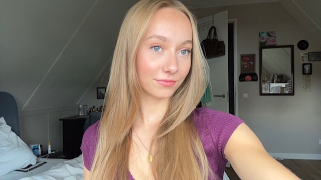

# Curriculum Vitae {-}

```{r profile-picture, echo=FALSE, out.width="30%", fig.align="left"}

```

```{r setup, include=FALSE}
knitr::opts_chunk$set(echo = FALSE, warning = FALSE, message = FALSE)
library(vitae)
```

## About me {-}

My name is Anouk Leendertse, and I am a third-year student of Biology and Medical Laboratory Research at the University of Applied Sciences Utrecht (Hogeschool Utrecht).

Although my educational background is in biology, my main interest lies in data science and data analysis. I enjoy working with data, exploring patterns and using programming tools such as R to analyse and interpret information.

Alongside my studies, I have gained several years of work experience in retail. These experiences have helped me develop strong communication skills, a sense of responsibility and the ability to work effectively in a team.

I am eager to further develop my skills in data science and gain practical experience in this field.

## Education {-}

```{r}
education <- tibble::tribble(
  ~Degree, ~Year, ~Institution, ~Location,
  "Biology and Medical Laboratory Research",
  "[Start year] - Present",
  "Hogeschool Utrecht",
  "Utrecht, The Netherlands"
)

knitr::kable(education)
```

## Work experience {-}

### Etos – Retail Assistant {-}

feb. 2024 – nov. 2025

- Assisting customers.
- Working in a customer-oriented environment.
- Maintaining store presentation and organisation.
- Working collaboratively with colleagues.


### Trekpleister – Retail Assistant & keyholder {-}

nov. 2025 – Present

- Taking responsibility for opening and closing store procedures.
- Helping customers with their purchases.
- Restocking products and maintaining the shop floor.
- Supporting daily store operations.
- Taking initiative and working independently when required.
- Working efficiently in a team.

## Technical skills {-}

Programming and data analysis
- Single-cell RNA sequencing (scRNA-seq)
- R programming
- Data manipulation and analysis
- Data visualisation
Software
- Microsoft Excel
- Microsoft Word
- Microsoft Office

## Personal skills {-}

- Analytical thinking
- Problem-solving
- Teamwork and collaboration
- Communication
- Responsibility
- Adaptability
- Attention to detail
- Willingness to learn

## Languages {-}

Dutch: Native/Fluent

English: B2 niveau
