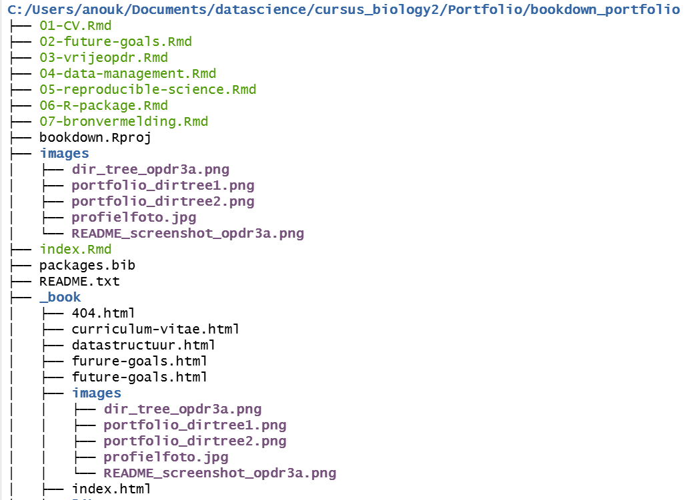
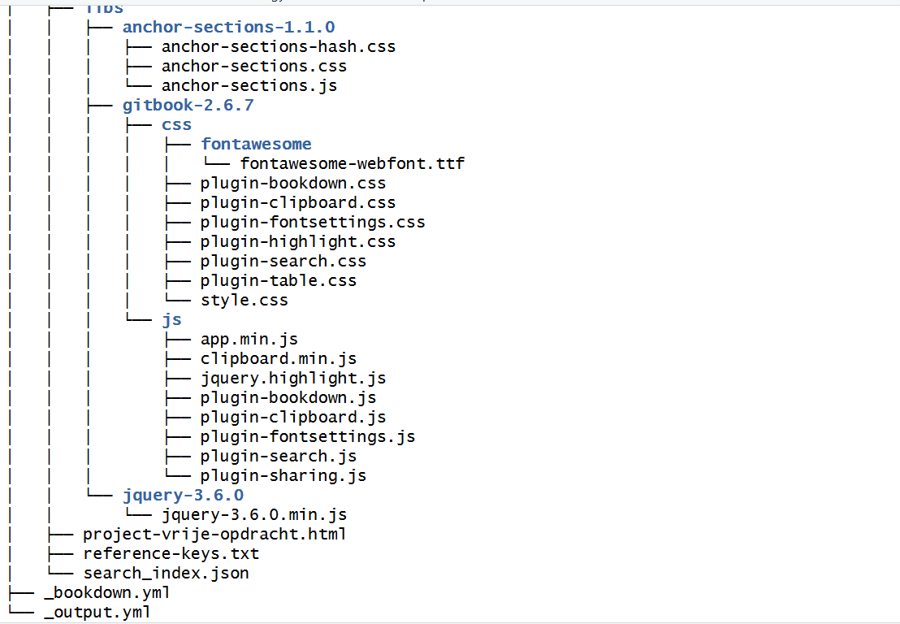

# Datastructuur {-}

### 3a {-}
```{r screenshot, echo=FALSE, out.width="30%", fig.align="left"}
knitr::include_graphics("images/dir_tree_opdr3a.png")
```

```{r screenshot2, echo=FALSE, out.width="30%", fig.align="left"}
knitr::include_graphics("images/README_screenshot_opdr3a.png")
```

```{r screenshot3, echo=FALSE, out.width="30%", fig.align="left"}
knitr::include_graphics("images/README_screenshot_opdr3a.png")
```

### 3b {-}

```{r screenshot4, echo=FALSE, out.width="30%", fig.align="left"}

```

```{r screenshot5, echo=FALSE, out.width="30%", fig.align="left"}

```

```{r, readme}
readLines("../README.md")
```

