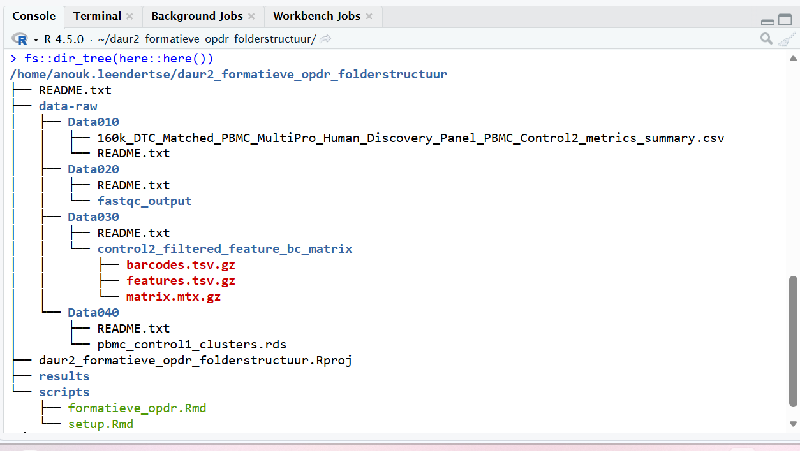
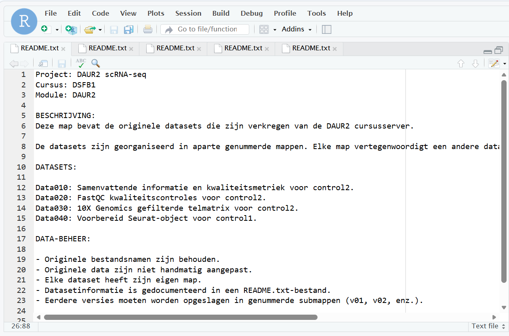
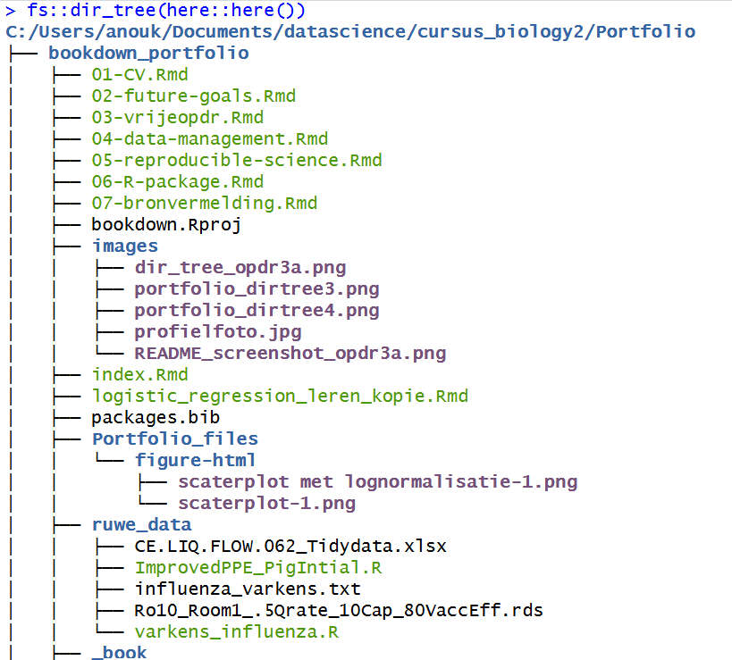

# Datastructuur {-}

### 3a {-}
```{r screenshot, echo=FALSE, out.width="30%", fig.align="left", fig.cap="Screenschot van de dir tree van de formatieve opdracht."}

```
Hier heb ik de mapjes en datasets van de formatieve opdracht nagebootst en op de manier van 'Guerilla Analytics regels voor data management' gedaan. 

Hier zijn nog een keer de regels voor Guerilla Analytics waar ik mij aan gehouden heb:

1. Create a separate folder for each analytics project . Keep the unit of a project small. So a larger research project can usually be subdivided into smaller projects. Create an analysis project for each sub-project. Don’t try to fit it all together.
2. Do not deeply nest folders (max 2-3 levels, so no project/documentation/applications/metc/first_communication/input/stuff/morestuff/mail.txt)
3. Keep information about the data, close to the data. So store descriptions about variables for example in a README.txt file and store that README.txt file in the same folder as where the data lives that it describes. When using Excel files, you may choose to store the README information in a separate worksheet. More on this later 3.5
4. Store each dataset in its own sub-folder. I usually work like the example below. Each dataset I receive goes in a numbered folder in the data-raw folder. If I recieve an updated file, I add the old file to a new folder called v01 inside the orginal Data.. folder. The updated file replaces the v01 file. If then you recieve yet another update, you can repeat this trick with a v02 folder inside the D.. folder. In this way, the file directly in the D.. folder is always the latest updated version. The README.txt file containing data about the data (see 3.5) lives also in the root of the Data.. folder.
5. Do not change file names or move them. As explained before, never change a file name of a file you recieve or download from the internet. If you need to change the file for analysis reasons (sometimes bioinformatics pipelines require specially formatted file names and than you do not have a choice, but to rename them), record your changes in the README.txt file!
6. Do not manually edit data source files. in fact Never, ever change a value inside a file. You can (almost) always solve this using code.
7. In code, use relative paths (here::here etc)
8. Use one R project per project (in RStudio -> RStudio Project) Don’t work outside of projects, and don’t reuse projects for other stuff.

Elke dataset staat in zijn eigen supfolder. De README, dus informatie over de data, staat in dezelfde map als de data. De file namen zijn niet veranderd net als de data erin. En als laatst is er 1 R project gebruikt per project, er is in dit geval maar 1 project. Ook zijn ben in niet te diep in de folders gaan zitten, max 3 lagen.


```{r screenshot2, echo=FALSE, out.width="30%", fig.align="left", fig.cap=" Screenschot van de README van de formatieve opdracht."}

```

Hierboven zie je de readme van de eerste map (daur2_formatieve_opdr_folderstructuur). Je ziet hier duidelijk en snel waar de data over gaat en het is andig om te hebben als anderen ook naar jouw data moeten kijken. Zo hebben ze een kleine samenvatting voordat ze beginnen.

### 3b {-}

```{r screenshot4, echo=FALSE, out.width="30%", fig.align="left", fig.cap="Screenschot van de dir tree van mijn bookdown."}

```

Hierboven in figuur 3 zie je de structuur van mijn bookdown. Ik heb ervoor gekozen om de Rmd bestanden zo te noemen dat ze netjes op volgoorde staan en heb verschillende mapen aangemaakt voor foto's en data. Ook een README staat in deze hoofdmap. Het is wel een beetje moeilijk om je bookdown helemaal via de regels van Guerilla Analytics te maken. Er zijn namelijk voor je portfolio verschillende opdrachten, waar je officieel verschillende projecten voor moet aanmaken, die je moet doen. Ook kan je niet zomaar alle Rmd bestanden in 1 map zetten, omdat ze in de hoofdfolder moeten staan voor je bookdown. Maar ik heb het zo overzichtelijk mogenlijk gedaan.

```{r, readme}
readLines("../README.md")
```

Hierboven is de readme te zien voor mijn portfolio, met de uitleg over waar de data en Rmd bestanden staan.
